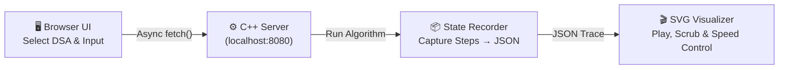

# 🚀 DSA Concepts Visualizer (C++ Backend + Modern Web UI)

-00599C?style=for-the-badge&logo=c%2B%2B&logoColor=white)


An interactive, full-stack **Data Structures & Algorithms (DSA) Visualizer** where a **native C++17 HTTP server** executes real algorithms, records every step as a JSON snapshot, and streams it to a **modern web interface** for smooth, step-by-step animation.

---

## ✨ Key Features

* **15+ Interactive DSA Visualizations:**
  * **Arrays (Sorting):** Bubble Sort, Selection Sort, Merge Sort, and Quick Sort.
  * **Linked Lists (Box Representation):** Singly, Doubly, Circular, and Doubly Circular Linked Lists with `[PREV | DATA | NEXT]` compartments, simulated memory addresses (`0x100`), `HEAD`/`TAIL` pointers, and loop-back arrows.
  * **Queues:** Linear Queue (FIFO), Circular Queue (Ring Buffer), Priority Queue (Max-Heap), and Deque (Double-Ended).
  * **Trees:** Complete Binary Tree (Pre-Order Traversal) and Dynamic Binary Search Tree (In-Order Traversal).
  * **Graphs:** Breadth-First Search (BFS) with live Queue and Visited tracking.
* **Custom User Input:** Test your own datasets (up to **20 elements**) and watch the C++ engine process them live.
* **Full Playback Controls:** Play, Pause, Step Forward (`▶`), Step Back (`◀`), and adjustable animation speed slider.
* **Built-in Concept & Complexity Guide:** Toggleable navbar panel detailing how each algorithm works, its **Time Complexity**, **Space Complexity**, and real-world use cases.
* **Final Result Banner:** Displays the final sorted array, traversal order, or pointer chain upon completion.
* **Dark & Light Mode:** Seamless theme switching across the UI and all SVG diagrams.

---

## 🏗️ System Architecture

Unlike browser-only visualizers written purely in JavaScript, this project uses a **Client–Server Architecture** with a zero-dependency C++ backend powered by Windows Sockets (`winsock2.h`):

```text
+-----------------------------------+        HTTP GET (Custom Input)        +-----------------------------------+
|        Modern Web Frontend        |  ---------------------------------->  |        Native C++17 Backend       |
|   (HTML5 + Tailwind CSS + SVG)    |    e.g., /api/sort?type=quick&data=   |     (server.cpp + Winsock2.h)     |
|                                   |                                       |                                   |
| • Parses JSON execution trace     |  <----------------------------------  | • Parses query parameters         |
| • Renders dynamic SVG & DOM bars  |       JSON Array of Step States       | • Runs actual C++ DSA logic       |
| • Manages Play/Pause/Step/Speed   |                                       | • Serializes each step into JSON  |
+-----------------------------------+                                       +-----------------------------------+
```
## 🔌 API Endpoints

All algorithm endpoints accept `GET` requests and return JSON step-by-step execution states.

| Method | Endpoint | Query Parameters | Description |
| :--- | :--- | :--- | :--- |
| `GET` | `/` | — | Serves the main frontend (`public/index.html`). |
| `GET` | `/api/sort` | `type` (`bubble`, `selection`, `merge`, `quick`), `data` | Returns step-by-step array states for sorting animations. |
| `GET` | `/api/bfs` | `start` (`0`–`5`) | Returns Breadth-First Search traversal steps and live queue states. |
| `GET` | `/api/tree` | `type` (`binary`, `bst`), `data` | Calculates node `(x, y)` layout coordinates and traversal order. |
| `GET` | `/api/ll` | `type` (`singly`, `doubly`, `circular`, `dcircular`), `data` | Returns linked list node insertion and pointer traversal steps. |
| `GET` | `/api/queue` | `type` (`linear`, `circular`, `priority`, `deque`), `data` | Returns enqueue/dequeue states with updated `front` and `rear` pointers. |

<details>
<summary><b>📄 Example Request & Response</b></summary>

**Request:**
```http
GET /api/sort?type=bubble&data=5,3,8,1
```

**Response (`200 OK`):**
```json
{
  "algorithm": "bubble",
  "steps": [
    { "array":, "comparing": [0, 1] },
    { "array":, "swapped": [0, 1] }
  ]
}
```
</details>
DSA Visualizer/
├── server.cpp           # Native C++17 HTTP server & complete DSA engine
├── public/
│   └── index.html       # Single-page frontend (Tailwind CSS, JS, SVG renderer)
├── .gitignore           # Excludes compiled binaries (*.exe) and editor configs
└── README.md            # Project documentation
## 🔄 Project Workflow



1. **User Selection:** Choose a DSA category, algorithm sub-type (e.g., *Quick Sort*, *Doubly Circular Linked List*), and custom comma-separated input in the UI.
2. **HTTP Request:** Clicking **Run C++** fires an asynchronous `fetch()` call to the local C++ backend (`http://localhost:8080`).
3. **C++ Execution:** `server.cpp` parses the input, runs the native C++ algorithm, and records every comparison, swap, pointer change, or traversal into a step-by-step state array.
4. **JSON Response:** The C++ server serializes the execution trace and returns the complete JSON payload over the HTTP socket.
5. **Visual Playback:** The frontend animates each snapshot with **SVG** and **CSS transitions**, supporting play/pause, speed adjustment, step scrubbing, and a **Final Result Banner**.
## ⚙️ Installation & How to Run

### Prerequisites
* **OS:** Windows (uses native `winsock2.h` for HTTP sockets)
* **Compiler:** MinGW / `g++` with **C++17** support

### Step-by-Step Setup (PowerShell / Terminal)

1. **Clone the repository:**
   ```powershell
   git clone https://github.com<your-repo-name>.git
   cd <your-repo-name>
   ```

2. **Compile the C++ server** (linking the Windows Socket library `-lws2_32`):
   ```powershell
   g++ -std=c++17 server.cpp -o server.exe -lws2_32
   ```

3. **Start the server:**
   ```powershell
   ./server.exe
   ```

> [!TIP]
> Once the server starts, open **`http://localhost:8080`** in your browser to launch the DSA Visualizer.

## 🎮 How to Use

1. **Pick a Category & Sub-Type:** Use the top navbar (**Array**, **Graph**, **Tree**, **Linked List**, **Queue**) and click any sub-type pill underneath.
2. **Enter Custom Input:**
   * **Array / Tree / Linked List / Queue:** Enter up to 20 comma-separated numbers between `1` and `999` (e.g., `45, 18, 72, 30, 90, 12, 55`).
   * **Graph BFS:** Enter a starting node from `0` to `5`.
3. **Click `Run C++`:** Watch the live step-by-step animation generated by the C++ engine.
4. **Control Playback:** Use **Play/Pause**, **◀ / ▶** to step through one operation at a time, or drag the **Speed** slider.
5. **Learn Concepts:** Click **📘 Concept & Complexity** in the navbar to view Time/Space complexities for the active algorithm, or click **☀️ / 🌙** to switch themes.

